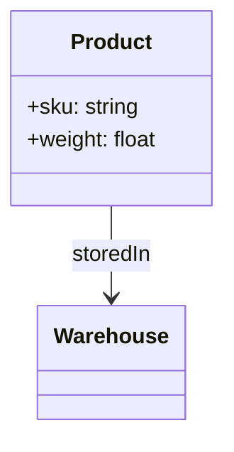
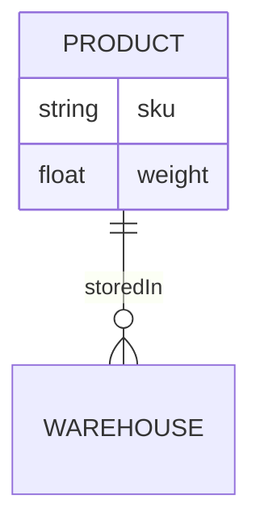

The exporters module turns a single `OntologyDefinition` into seven standard formats. Every exporter follows the same shape: construct with the ontology (plus options), then call `export()`.

```typescript
import {
  MermaidExporter,
  OWLExporter,
  SHACLExporter,
  JsonSchemaExporter,
  DotExporter,
  ErDiagramExporter,
  CytoscapeExporter,
} from "@ontograph/core";

new MermaidExporter(ontology).export();            // Mermaid classDiagram / graph
new OWLExporter(ontology).export();                // OWL 2 Turtle (W3C)
new SHACLExporter(ontology).export();              // SHACL Shapes in Turtle (W3C)
new JsonSchemaExporter(ontology).exportString();   // JSON Schema Draft 2020-12
new DotExporter(ontology).export();                // Graphviz DOT
new ErDiagramExporter(ontology).export();          // Mermaid erDiagram
new CytoscapeExporter(ontology).export();          // Cytoscape.js elements
```

For Neo4j DDL (constraints, indexes, label mappings), see [Query Engine → Neo4j Schema Generation](/docs/core/query#neo4j-schema-generation) — `Neo4jSchemaGenerator` lives in the transformer module, not the exporters.

## Format Overview

| Exporter | Output | Use case |
|---|---|---|
| `OWLExporter` | OWL 2 DL Turtle | W3C ontology tooling (Protégé, triple stores) |
| `SHACLExporter` | SHACL Shapes (Turtle) | W3C data validation pipelines |
| `JsonSchemaExporter` | JSON Schema 2020-12 | API contracts, form validation |
| `MermaidExporter` | Mermaid `classDiagram` / `graph` | GitHub READMEs, docs |
| `ErDiagramExporter` | Mermaid `erDiagram` | Entity-relationship views |
| `DotExporter` | Graphviz DOT | Publication-quality diagrams |
| `CytoscapeExporter` | `CytoscapeElementDefinition[]` | Interactive graph UIs (Cytoscape.js) |

Try all of them live on the [Export Demo](/exports-demo) page.

## Mermaid Exporter

```typescript
const exporter = new MermaidExporter(ontology, {
  diagramType: "classDiagram", // "classDiagram" | "graph" | "flowchart"
  includeAttributes: true,
  includeRelations: true,
  includeValueTypes: true,
  showKind: false,             // annotate nodes with entity/event/role/value kind
  direction: "TB",             // "TB" | "BT" | "LR" | "RL"
  title: "Supply Chain",
  colorPalette: ["#E1F5FE", "..."], // auto-assigned per namespace
});

const diagram: string = exporter.export();
```

Output renders natively in GitHub READMEs and any Mermaid-compatible viewer:



## OWL Exporter

Full documentation, including the complete mapping table and constraint/interface export rules: [OWL 2 / JSON-LD Export](/docs/core/owl-export).

```typescript
const turtle = new OWLExporter(ontology, {
  includeAnnotations: true,   // rdfs:label / rdfs:comment (default: true)
  includeImports: false,      // owl:imports (default: false)
  baseIRI: "https://supply-chain.example/ontology/",
}).export();
```

## SHACL Exporter

Generates W3C SHACL NodeShapes in **Turtle** — ready for `shacl` CLI, Apache Jena, TopBraid:

```typescript
const shapesTtl = new SHACLExporter(ontology, {
  includeAnnotations: true,
  baseIRI: "https://supply-chain.example/ontology/",
  targetClassPrefix: "sc",      // prefix used for sh:targetClass
}).export();
```

<Callout type="info">
Two SHACL APIs exist, for different pipelines:

- **`SHACLExporter`** (this module) — emits SHACL shapes as a **Turtle string**, for external RDF tooling.
- **`SHACLShapeGenerator`** ([validation module](/docs/core/shacl)) — emits shapes as a **JSON-LD object** for in-process validation with `SHACLValidator`.
</Callout>

## JSON Schema Exporter

```typescript
const exporter = new JsonSchemaExporter(ontology, {
  includeAnnotations: true,   // title / description from labels
  baseURI: "https://supply-chain.example/schemas/",
  language: "zh",             // label language preference: "en" | "zh"
});

const schemaObject = exporter.export();       // Record<string, unknown> — Draft 2020-12 with $defs
const schemaString = exporter.exportString(); // pretty-printed JSON
```

## DOT Exporter (Graphviz)

```typescript
const dot = new DotExporter(ontology, {
  layout: "dot",           // "dot" | "neato" | "fdp" | "sfdp" | "circo" | "twopi"
  direction: "TB",         // "TB" | "LR" | "BT" | "RL"
  showAttributes: true,
  maxLabelLength: 24,
  colorScheme: ["#E3F2FD", "..."], // node fills, auto-assigned
}).export();
```

Entity kinds map to Graphviz shapes: `entity → box`, `event → diamond`, `role → ellipse`, `value → note`.

## ER Diagram Exporter

Mermaid `erDiagram` syntax — a relational view of the ontology:

```typescript
const er = new ErDiagramExporter(ontology, {
  includeAttributes: true,
  includeValueTypes: true,
  title: "Supply Chain ER",
}).export();
```



## Cytoscape Exporter

Produces element definitions for [Cytoscape.js](https://js.cytoscape.org/) — nodes carry kind colors, labels and cardinality metadata:

```typescript
const elements = new CytoscapeExporter(ontology, {
  language: "zh",                    // label preference, falls back en → zh → local name
  includeRelationTypeNodes: false,   // true: materialize relations as intermediate nodes
  includeValueTypes: true,
  includeInheritance: true,          // extends edges
  labelWithCardinality: false,       // edge labels like "发货 (0..n)"
  kindColors: { entity: "#B93A2E" }, // override per-kind colors
  positions: { "sc:Product": { x: 0, y: 0 } }, // for "preset" layouts
}).export();

cy.add(elements); // CytoscapeElementDefinition[]
```

A functional shortcut is also available:

```typescript
import { toCytoscapeElements } from "@ontograph/core";

const elements = toCytoscapeElements(ontology, { language: "zh" });
```
